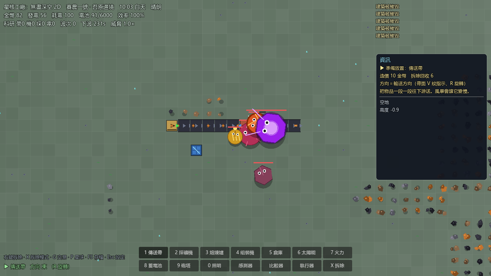
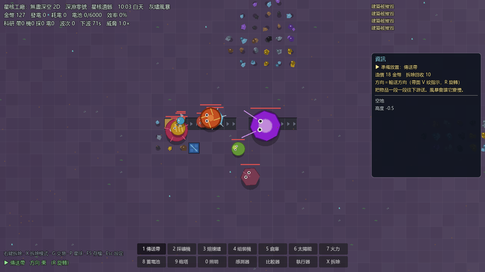

# 星核工厂：无尽深空　Core Factory: Infinite Horizon

> 一款 2D 俯视角「异星自动化工厂 × 虫潮生存」游戏。
> 从手动拓荒开始，铺起能自己运转的传送带帝国，再在定时来袭的虫潮中活下来、扩张到无尽深空。

终局星球「深渊零号」（星核矿 + 灰尘风暴 + 星核兽 BOSS）：

## 玩法闭环

- **采集与物流**：采矿机开采铁/铜/煤/石（灰烬星还有稀有钛矿）→ 传送带网络输送。
- **加工生产**：熔炼炉 → 组装机，产出齿轮、电路、科研包、炮弹。
- **电力网**：太阳能板、火力发电机（烧煤）、蓄电池；缺电整厂降速。
- **逻辑电路**：传感器 → 比较器 → 执行器，自动开关机器。
- **生存防御**：定时虫潮（潮虫/迅虫/毒液虫/重甲虫/巢主 5 种），炮塔自动防守。
- **金币经济**：卖矿换金币、金币盖建筑；矿价/建筑价随市场浮动；可贷款（利滚利）。
- **无限研究**：消耗科研包永久强化，成本 1.6 倍递增。
- **动态难度**：虫潮强度随你的基地实力自动调整。

## 特性亮点

- **单文件 EXE**：`dist/CoreFactory2D_v0.2.0.exe`（约 190 MB），双击即玩，无需安装、无附带文件。
- **程序化美术**：零贴图，所有建筑/物品/矿脉/怪物都用向量几何实时绘制，工业风。
- **程序化音效与音乐**：零音频文件，全部执行期合成。
- **无限地图**：区块式地形串流，视口外自动加载/卸载（坐标上限 ±32760）。
- **中文 UI**：图鉴、新手教学、信息栏、小地图、研究、交易、设置、存读档、主菜单、失败画面。
- **可扩展架构**：模拟核心（`game2d/src/Core/`）是纯 C#、零引擎依赖，可单独编译、可压测、可移植。

## 操作

| 操作 | 键 |
| --- | --- |
| 平移视角 | `WASD` / 方向键；滚轮缩放；中键拖拽 |
| 选建造工具 | `1-9`,`0` 或点底部工具列；`[` `]` 循环 |
| 放置 / 拆除 | 左键放置；右键或 `X` 拆除 |
| 旋转 / 配方 | `R` 旋转；`Ctrl+滚轮` 换配方 |
| 蓝图 | `C` 复制 / `V` 粘贴 |
| 交易 / 星球 / 研究 | `G` 交易（卖矿、贷款）/ `P` 星球 / `U` 研究 |
| 图鉴 / 说明 / 设置 | `F1` / `H` / `Esc` |
| 存读档 | `F5` 手动存档；自动存档每 30 秒 + 关窗口自动存 |
| 小地图 / 暂停 | `M` / `空格` |

### 新手友好设计

- **五个星球**：赛农一号（新手）→ 灰烬九号（钛矿）→ 翡翠七星（矽矿/高级电路）→ 霜蚀四号（晶石/金矿）→ 深渊零号（星核晶，终局）。每颗星有**专属矿池、专属虫种、天气与日照**，矿物卖价 ×1.0→×3.2、建筑造价 ×1.0→×1.8 递增。
- **传送门解锁**：按 `P` 开星球面板，花金币开通传送门（$8,000 / $25,000 / $70,000 / $180,000），**且必须还清所有贷款**才能开通。
- **10 种虫子**：潮虫/迅虫/毒液虫/重甲虫/巢主 + 自爆虫（冲到建筑旁自爆）/飞行虫（绕过防线）/霜蚀虫（冰甲厚）/熔岩虫/星核兽（BOSS）。
- **10 种新物品**：矽矿→矽晶圆、晶石矿→晶体、金矿→金板、星核矿→星核晶、高级电路、穿甲弹（炮塔伤害加倍）。
- **熔炼炉自动识别矿种**：铜矿送上带子就自动熔成铜板（不再只会熔铁），也可用 `Ctrl+滚轮` 手动指定配方。
- **炮塔出厂附赠 20 发弹药**：开局立刻能防守，之后用传送带补「炮弹」（组装机：齿轮＋铜板），一次补满 30 发；喂「穿甲弹」伤害 ×2。
- **开局即有 200 发炮弹库存**。
- **14 步循序渐进教学**：从第一台采矿机一路教到做出炮弹、送进炮塔、升级研究，每步都有「怎么做」的详细提示，可随时跳过或重开。
- **放置前看属性**：右侧资讯栏显示当前工具的造价／拆除回收／耗电／配方／进出料方向与用途说明。

